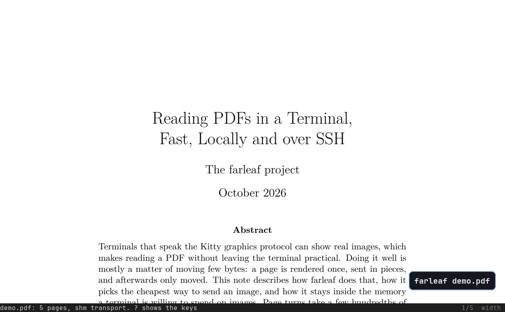

# farleaf

A fast, minimal PDF reader for the terminal, with Vim keys. It shows the pages
as real images through the Kitty graphics protocol, and it stays fast over SSH
and inside [herdr](https://herdr.dev).



- Renders with [MuPDF](https://mupdf.com), compiled in: one binary, nothing
  else to install. Pages heavy with images (scans) render on several cores.
- Turning a page usually only moves images that are already in the terminal; a
  jump to a new page is on screen in 10-30 ms locally, about 0.1 s over SSH.
- Picks the fastest way to send images by asking the terminal at startup:
  shared memory locally, compressed images over SSH.
- A sidebar with the outline (sections and subsections) or page thumbnails,
  as in macOS Preview: `o` or `t`, then `j` `k` to look around and Enter to go.
- Reloads by itself when the file changes, for example after a LaTeX run.
- SyncTeX both ways: an editor's forward search opens farleaf at the line, and
  Ctrl-click (or `gd`) goes back to the source, in Neovim with VimTeX, say.

## Install

macOS (Apple Silicon or Intel) and Linux (x86_64 or arm64):

```sh
curl -fsSL https://raw.githubusercontent.com/matthewgson/farleaf/main/install.sh | sh
```

This puts `farleaf` in `~/.local/bin` (checked against the release's
checksums) and its licenses in `~/.local/share/doc/farleaf`. No root needed.
Set `FARLEAF_PREFIX` to install elsewhere, or `FARLEAF_VERSION=v0.4.0` for a
specific release. Linux needs glibc 2.28 or later. To uninstall:
`rm ~/.local/bin/farleaf && rm -r ~/.local/share/doc/farleaf`.

### From source

Needs Rust, `make` and a C/C++ compiler (MuPDF is C, with a little C++).

```sh
git clone https://github.com/matthewgson/farleaf && cd farleaf
scripts/fetch-mupdf.sh       # MuPDF's source, pinned and checksummed, into vendor/
cargo build --release        # compiles MuPDF too, about a minute the first time
cp target/release/farleaf ~/.local/bin/
```

## Use

```sh
farleaf paper.pdf
farleaf -p 12 paper.pdf      # open at page 12
farleaf -p 12:340:96 paper.pdf  # ... with the spot 340 pt down, 96 across, a third of the way down
farleaf docs/demo/demo.pdf   # the paper in the GIF, in a clone of this repo
```

Press `?` for the list of keys. A count works before most keys: `5j`, `3l`, `12G`.

| Keys | Action |
|---|---|
| `j` `k`, `↓` `↑` | scroll |
| `Ctrl-d` `Ctrl-u` | half a screen down / up |
| `Space` `Ctrl-f` `PgDn`, `Ctrl-b` `PgUp` | a screen down / up |
| `l` `h`, `J` `K` | next / previous page |
| `gg`, `G`, `12G` | first page, end, page 12 |
| `z`, `Z` | fit page, fit width |
| `+` `-` | zoom in / out |
| `H` `L`, `←` `→` | pan when zoomed wider than the screen |
| `i` | invert colors |
| `/`, `n` `N` | search (smartcase), next / previous match |
| `Esc` | clear search highlights |
| `m{a-z}`, `'{a-z}` | set a mark, go to a mark |
| `''`, `Ctrl-o`, `Tab` | jump back, back in the jump list, forward |
| `o` | the outline (contents) in a sidebar; again to hide it |
| `t` | page thumbnails in a sidebar; again to hide them |
| in the sidebar: `j` `k`, `Enter`, `Esc` | move (the page follows), stay there, go back to where you were |
| `:12` `:12:340:96` `:q` `:noh` `:e` | go to page 12 (at 340 pt from its top, 96 across), quit, clear highlights, reload |
| `Ctrl`-click, `gd` | LaTeX: the source of the line clicked, or of the search match or the line a third of the way down (see below) |
| `v` `V` | visual mode: a text cursor (`v`), then select by characters / lines, `y` copies, `gd` goes to the source (see below) |
| `r` | reload |
| `?`, `:help` | the key list |
| `q`, `Ctrl-c` | quit |

### The status line

The bottom line is drawn like Neovim's in LazyVim (lualine, tokyonight
colors): the mode on the left (`NORMAL`, `CURSOR`, `VISUAL`, `V-LINE`,
`COMMAND` while typing after `:` or `/`, `OUTLINE` and `PAGES` in the
sidebar), the file, then a message or the keys that work now. On the right,
as Vim's showcmd, the keys of a command that waits for more (`12`, `g`,
`2y`, `f`), then the view, how far down (`Top`, `42%`, `Bot`) and the page.
The separators are Nerd Font glyphs, which Ghostty has built in.

### Visual mode

`v` puts a text cursor on the page, with nothing selected yet (`CURSOR` in
the status line, like Vim's normal mode): where a forward search (SyncTeX) just went, else
where it was when you last left visual mode if that still shows, else on the
search match, else at the start of the third line of text from the top of the
screen. `v` again starts selecting from the cursor (`VISUAL`), `V` by whole
lines (`V-LINE`); `v` once more stops selecting, or, if you have not moved since
starting, leaves. `Esc` leaves at any time.

The cursor moves as in Vim, with counts: `h j k l`, `w b e` and `W B E`,
`0 ^ $`, `{ }`, `f F t T` and `; ,` along the line, `gg G` (`5G`: page 5),
`H M L` on the screen, `Ctrl-d/u/f/b`; `n`/`N` follow search matches. While
selecting, `o` swaps the ends; `iw aw iW aW` select a word (with just the
cursor they start selecting it, so `v` `iw` `y` copies the word). Lines are the
lines you see: the cells of a table row, or the far-apart words of a
justified line, are one line.

- `y` copies the selection to the system clipboard and leaves the cursor at
  its start, as in Vim; with just the cursor, `y` takes a motion or object
  (`yy` or `Y` the line, `yw`, `y$`, `yt.`, `yiw`, ...). It uses OSC 52, the
  way Neovim does over SSH, so it reaches the clipboard of the machine you
  sit at (Ghostty, through herdr and SSH) with nothing installed on the
  remote side. By characters, the lines of a paragraph run together and a
  word broken by a hyphen is mended; by lines (`V`, `yy`), lines stay as they
  are.
- `gd` goes to the source line of the cursor's character (SyncTeX, set up
  below), and stays in visual mode.

### LaTeX and SyncTeX

Run LaTeX with `-synctex=1` (latexmk and VimTeX do) and farleaf goes both ways
between the PDF and its source:

- **Source to PDF.** `synctex view` gives a source line's page, height and
  place across, so an editor's forward search can open farleaf there
  (`farleaf -p 12:340:96 paper.pdf`) or type `:12:340:96` and Enter into a
  farleaf that is already open. The line lands a third of the way down the
  screen, with the text cursor (visual mode, `CURSOR`) on the word where the
  source line starts, near enough: SyncTeX knows boxes, not letters. `gd`
  goes back, `v` selects from there, `Esc` leaves.
- **PDF to source.** Ctrl-click a line, or press `gd` for the current search
  match or else the line a third of the way down (so `gd` right after a
  forward search goes back to the same line). Right-click works as Ctrl-click,
  except in herdr, which keeps right-click for its menu. farleaf runs
  `synctex edit` (TeX Live's; TinyTeX: `tlmgr install synctex`) and then the
  command in `FARLEAF_SYNCTEX_EDITOR`, with `{file}`, `{line}` and `{column}`
  filled in. Without the variable, farleaf shows the source line in its
  status line.

Set the editor command once, in your shell's startup file, so every farleaf
you start has it. For Neovim with [VimTeX](https://github.com/lervag/vimtex),
whose `VimtexInverseSearch` finds the Neovim that has the project open and
goes to the line there:

```sh
# zsh: ~/.zshrc   bash: ~/.bashrc
export FARLEAF_SYNCTEX_EDITOR='nvim --headless -c "VimtexInverseSearch {line} {file}" -c "quitall!"'
```

```fish
# fish: ~/.config/fish/config.fish
set -gx FARLEAF_SYNCTEX_EDITOR 'nvim --headless -c "VimtexInverseSearch {line} {file}" -c "quitall!"'
```

Open a new shell (or `source` the file) for it to take effect. Other editors:

| Editor | `FARLEAF_SYNCTEX_EDITOR` |
|---|---|
| Vim with VimTeX | `vim -v --not-a-term -T dumb -c "VimtexInverseSearch {line} {file}" -c "quitall!"` |
| VS Code | `code --goto {file}:{line}:{column}` |
| Emacs (server running) | `emacsclient --no-wait +{line}:{column} {file}` |

The command is split into words as a shell would (quotes work) but runs
without a shell and without the terminal, so a path with spaces in it stays
one argument; for anything more, make it a script. farleaf turns on mouse
reporting only for a PDF with SyncTeX data beside it (`paper.synctex.gz`);
the wheel scrolls as before.

## Terminals

| Terminal | Status |
|---|---|
| [Ghostty](https://ghostty.org) | tested, locally and over SSH |
| [herdr](https://herdr.dev) | tested, locally and over SSH; detected automatically |
| other terminals with the Kitty graphics protocol (kitty, ...) | should work, untested |
| tmux | not supported |

Over SSH, run farleaf on the remote machine. If you read PDFs inside herdr over
SSH, turn on SSH compression for that host; it makes page turns several times
faster:

```
# ~/.ssh/config
Host my-server
    Compression yes
```

## More

- [How it works](docs/how-it-works.md): why it is fast, and measurements.
- [Development](docs/development.md): tests, the fake terminal, making a release.

## License

farleaf is © 2026 Matthew G. Son, under the [GNU Affero General Public
License](LICENSE), version 3 or later (AGPL-3.0-or-later). It is built with
MuPDF, © Artifex Software, which is under the AGPL too; the libraries inside
MuPDF have their own licenses, in `licenses/` in each release archive. Each
release also carries MuPDF's exact source. Releases before 0.4.0, which
rendered with pdfium, were MIT.
