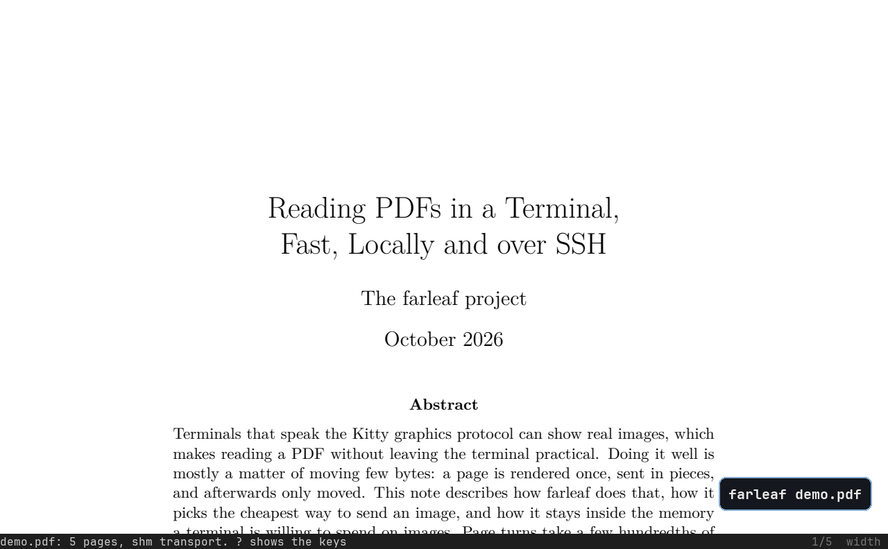

# farleaf

A fast, minimal PDF reader for the terminal, with Vim keys. It shows the pages
as real images through the Kitty graphics protocol, and it stays fast over SSH
and inside [herdr](https://herdr.dev).



- Renders with [pdfium](https://pdfium.googlesource.com/pdfium/), Chrome's PDF engine.
- Turning a page usually only moves images that are already in the terminal; a
  jump to a new page is on screen in 20-30 ms locally, about 0.1 s over SSH.
- Picks the fastest way to send images by asking the terminal at startup:
  shared memory locally, compressed images over SSH.
- A sidebar with the outline (sections and subsections) or page thumbnails,
  as in macOS Preview: `o` or `t`, then `j` `k` to look around and Enter to go.
- Reloads by itself when the file changes, for example after a LaTeX run.

## Install

macOS (Apple Silicon or Intel) and Linux (x86_64 or arm64):

```sh
curl -fsSL https://raw.githubusercontent.com/matthewgson/farleaf/main/install.sh | sh
```

This puts `farleaf` in `~/.local/bin` and pdfium in `~/.local/lib/farleaf`,
checking both against the release's checksums. No root needed. Set
`FARLEAF_PREFIX` to install elsewhere, or `FARLEAF_VERSION=v0.1.0` for a
specific release. To uninstall: `rm ~/.local/bin/farleaf && rm -r ~/.local/lib/farleaf`.

### From source

Needs Rust. pdfium is loaded at run time, so there is no C build.

```sh
git clone https://github.com/matthewgson/farleaf && cd farleaf
scripts/fetch-pdfium.sh      # a pinned, checksummed pdfium build, into vendor/
cargo build --release        # target/release/farleaf finds vendor/ by itself
```

To install it, copy `target/release/farleaf` to `~/.local/bin/` and
`vendor/pdfium-*/lib/libpdfium.*` to `~/.local/lib/farleaf/`.

## Use

```sh
farleaf paper.pdf
farleaf -p 12 paper.pdf      # open at page 12
farleaf docs/demo/demo.pdf   # the paper in the GIF, in a clone of this repo
```

Press `?` for the list of keys. A count works before most keys: `5j`, `3l`, `12G`.

| Keys | Action |
|---|---|
| `j` `k`, `↓` `↑` | scroll |
| `Ctrl-d` `Ctrl-u` | half a screen down / up |
| `Space` `Ctrl-f` `PgDn`, `Ctrl-b` `PgUp` | a screen down / up |
| `l` `h`, `J` `K` | next / previous page |
| `gg`, `G`, `12G` | first page, end, page 12 |
| `z`, `Z` | fit page, fit width |
| `+` `-` | zoom in / out |
| `H` `L`, `←` `→` | pan when zoomed wider than the screen |
| `i` | invert colors |
| `/`, `n` `N` | search (smartcase), next / previous match |
| `Esc` | clear search highlights |
| `m{a-z}`, `'{a-z}` | set a mark, go to a mark |
| `''`, `Ctrl-o`, `Tab` | jump back, back in the jump list, forward |
| `o` | the outline (contents) in a sidebar; again to hide it |
| `t` | page thumbnails in a sidebar; again to hide them |
| in the sidebar: `j` `k`, `Enter`, `Esc` | move (the page follows), stay there, go back to where you were |
| `:12` `:q` `:noh` `:e` | go to page 12, quit, clear highlights, reload |
| `r` | reload |
| `?`, `:help` | the key list |
| `q`, `Ctrl-c` | quit |

## Terminals

| Terminal | Status |
|---|---|
| [Ghostty](https://ghostty.org) | tested, locally and over SSH |
| [herdr](https://herdr.dev) | tested, locally and over SSH; detected automatically |
| other terminals with the Kitty graphics protocol (kitty, ...) | should work, untested |
| tmux | not supported |

Over SSH, run farleaf on the remote machine. If you read PDFs inside herdr over
SSH, turn on SSH compression for that host; it makes page turns several times
faster:

```
# ~/.ssh/config
Host my-server
    Compression yes
```

## More

- [How it works](docs/how-it-works.md): why it is fast, and measurements.
- [Development](docs/development.md): tests, the fake terminal, making a release.

## License

MIT. The release archives include pdfium, which is under the BSD 3-clause
license and others (see `pdfium-licenses/` in each archive).
